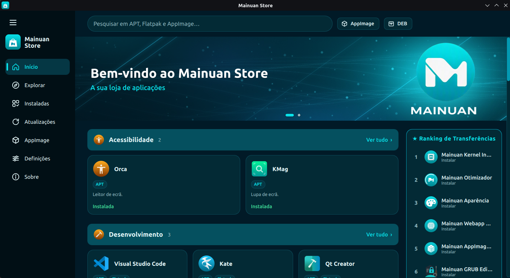
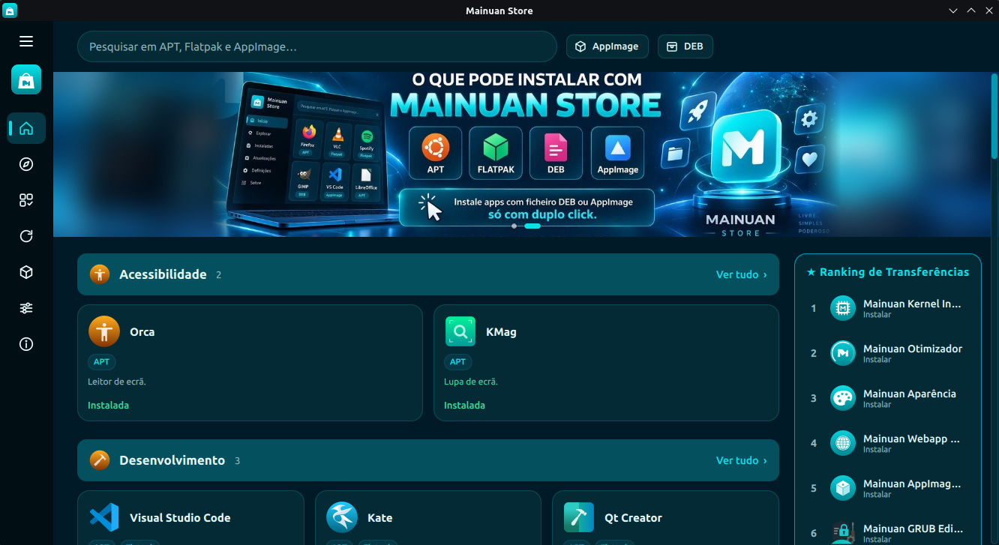
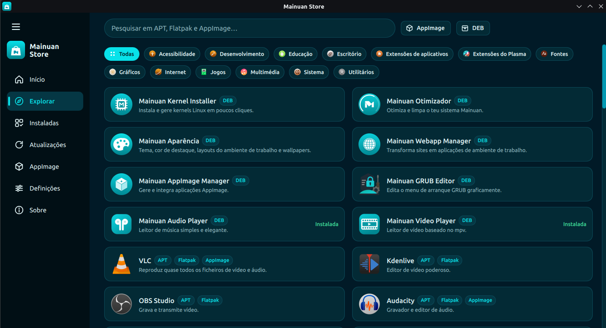
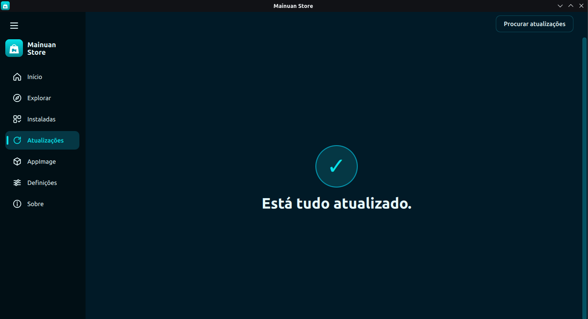
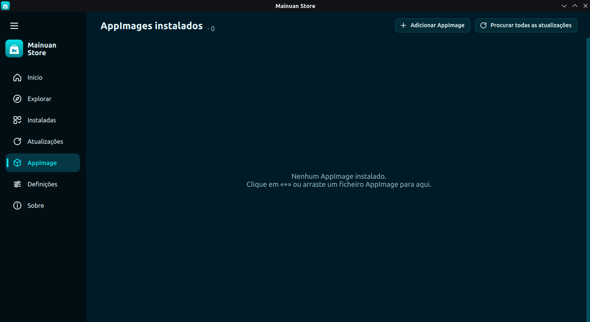

<div align="center">


# MAINUAN STORE


Centro de software gráfico da distribuição **Mainuan**. Instala, atualiza e remove aplicações a partir de **APT, Flathub (Flatpak), AppImage e ficheiros DEB locais**, e dá destaque às aplicações feitas de raiz para a Mainuan. Mostra as atualizações disponíveis e avisa-te na área de notificações.

</div>

## Screenshots

<div align="center">
  
  
  
</div>
<div align="center">
  
  
</div>

## Funcionalidades

- **Início:** banner de boas-vindas e banners rotativos (a cada 7 segundos), aplicações **Feito para o Mainuan**, aplicações por categoria e o **Ranking de Transferências**.
- **Explorar:** catálogo com **42 aplicações** em 13 categorias (Acessibilidade, Desenvolvimento, Educação, Escritório, Extensões de aplicações, Extensões do Plasma, Fontes, Gráficos, Internet, Jogos, Multimédia, Sistema e Utilitários), mais pesquisa em **APT, Flatpak e AppImage**.
- **Várias fontes por aplicação:** cada aplicação mostra se está disponível em APT, Flatpak ou AppImage. Escolhes a **fonte padrão** e podes instalar de outra quando quiseres.
- **Instaladas:** vê e remove o que tens instalado.
- **Atualizações:** atualiza tudo com um clique (APT, Flatpak, AppImage e, se tiveres o `fwupd` instalado, firmware).
- **Avisos de atualizações:** ícone na área de notificações com o número de atualizações disponíveis (pode ser desativado nas Definições).
- **AppImage:** instala um ficheiro AppImage escolhendo-o ou **arrastando-o para a janela**, integra-o no menu e atualiza-o a partir de um URL do GitHub, GitLab, Codeberg ou ligação direta.
- **Ficheiros DEB e AppImage:** a Mainuan Store abre-os com duplo clique no gestor de ficheiros.
- **Definições:** fonte padrão, repositórios APT e Flatpak (incluindo adicionar um `.flatpakrepo`), atualizações de firmware (LVFS) e aviso de atualizações.
- **Menu lateral reduzido ou expandido:** a tua escolha fica guardada.
- **Multilingue:** português (PT), português (BR), inglês, francês e espanhol.

### Segurança

As operações que precisam de administrador passam por **polkit (`pkexec`)** e por um programa auxiliar (`helper.py`) que só aceita uma lista restrita de comandos e argumentos, e recusa tudo o resto.

## Feito para o Mainuan

Aplicações exclusivas, instaladas e atualizadas a partir das *releases* do GitHub de cada projeto:

| Aplicação | Categoria | Descrição |
|---|---|---|
| **Mainuan Kernel Installer** | Sistema | Instala e gere kernels Linux em poucos cliques. |
| **Mainuan Otimizador** | Sistema | Otimiza e limpa o teu sistema Mainuan. |
| **Mainuan Aparência** | Plasma | Tema, cor de destaque, layouts do ambiente de trabalho e wallpapers. |
| **Mainuan Webapp Manager** | Internet | Transforma sites em aplicações de ambiente de trabalho. |
| **Mainuan AppImage Manager** | Sistema | Gere e integra aplicações AppImage. |
| **Mainuan GRUB Editor** | Sistema | Edita o menu de arranque GRUB graficamente. |
| **Mainuan Audio Player** | Multimédia | Leitor de música simples e elegante. |
| **Mainuan Video Player** | Multimédia | Leitor de vídeo baseado no mpv. |
| **Mainuan Gerenciador Tarefas** | Sistema | Gerenciador do sistema. |
| **Mainuan Limpeza** | Sistema | Limpeza do sistema. |

## Requisitos

- Distribuição baseada em **Debian/Ubuntu** (APT e `dpkg`) com **polkit** (`pkexec`)
- Python 3.10 ou superior
- PySide6 (`python3-pyside6.*`), `libqt6svg6` e os módulos QML do Qt 6 (Quick, Controls, Layouts, Window e Dialogs)
- Recomendados: `flatpak`, `fwupd`, `python3-yaml`, `libfuse2t64` (ou `libfuse2`) e `desktop-file-utils`

## Instalação

Descarrega o ficheiro `.deb` mais recente na página de [Releases](../../releases) e instala:

```bash
sudo apt install ./mainuan-store_0.7.0_all.deb
```

Depois abre **Mainuan Store** no menu de aplicações, ou executa no terminal:

```bash
mainuan-store
```

## Compilar o pacote a partir do código

```bash
git clone https://github.com/mainuan/mainuan-store.git
cd mainuan-store
dpkg-deb --root-owner-group --build package mainuan-store_0.7.0_all.deb
```

## Estrutura do projeto

```text
mainuan-store/
├── package/
│   ├── DEBIAN/              # control, postinst, postrm
│   ├── etc/xdg/autostart/   # avisos de atualizações no arranque
│   └── usr/
│       ├── bin/             # mainuan-store e mainuan-store-tray
│       └── share/
│           ├── applications/, doc/, icons/
│           └── mainuan-store/   # código Python (main, backend, helper, tray, appimage_core, strings),
│                                # interface QML, dados (apps.json, catalog.json), banners e imagens
├── assets/screenshots/
├── .github/workflows/       # compilação automática do pacote
├── CHANGELOG.md
├── LICENSE
└── README.md
```

## Banners de publicidade

Para mostrar um banner no Início basta colocar a imagem (1920 × 384 px, JPG, PNG ou WEBP) em `package/usr/share/mainuan-store/banners/`, compilar o pacote e atualizar a app. Vê as instruções completas em [`LEIA-ME.txt`](package/usr/share/mainuan-store/banners/LEIA-ME.txt).

## Licença

Distribuído sob a licença **GPL-3.0 ou posterior**. Vê o ficheiro [LICENSE](LICENSE).

## Autor

**David Caixinha** — tugatechlabDC

## [0.7.0] - 2026-11-26

### Adicionado
- 2 novas apps exclusivas Mainuan (total 10): **Mainuan Gerenciador Tarefas** (9.º) e **Mainuan Limpeza** (10.º).
- Banner "10 apps exclusivas Mainuan" (2.º banner, até 2027-08-30) com as 2 apps novas.
- Ícone da loja em 7 cores (azul por defeito, brow, claro, gray, green, red, rosa) que muda sozinho com a cor do sistema (KDE Plasma e GNOME). Pode forçar-se uma cor em `~/.config/mainuan-store/icon-color`.
- A própria Mainuan Store passa a atualizar-se pelas Atualizações da loja quando há uma nova release em github.com/mainuan/mainuan-store.
- Dependência nova: `libglib2.0-bin` (gdbus, para as notificações do sistema).

### Alterado
- A coluna "Ranking de Transferências" passa a **Recomendamos**.
- Ao abrir a loja, a cache é limpa e as atualizações são verificadas logo.
- No arranque do sistema, a verificação de atualizações é imediata (espera pela rede, se for preciso) e notifica na barra de notificações do sistema.
- Novo ícone azul (SVG + PNG 16/22/24/32/48; os PNG 64/128/256 foram removidos e o SVG escalável serve esses tamanhos).
- Versão das releases: a loja usa a tag (ex.: `v2.0`) como versão quando a tag é um número de versão.

### Corrigido
- A notificação de atualizações desaparece logo que as atualizações terminam.

## [0.6.3] - 2026-11-21

### Adicionado
- Banner temporário "8 apps exclusivas Mainuan" (`banners/00-apps-exclusivas-mainuan.jpg`), mostrado como 2.º banner, logo a seguir ao BEM-VINDO, de 2026-11-21 até 2027-08-30 (configurado em `banners/banners.json`).
- Pasta `/appimage` na raiz do disco, criada na instalação.

### Alterado
- As AppImages passam de `~/AppImages` para `/appimage`. As que já existiam são migradas automaticamente.
- `/appimage` fica protegida enquanto houver AppImages configuradas na loja: dono root e atributo imutável, sem permissões para o utilizador apagar ou alterar pastas ou ficheiros. Adicionar, atualizar e remover AppImages passa pelo helper (pkexec).
- Ao desinstalar a loja, a proteção é retirada e a pasta é devolvida ao utilizador.
- Novo ícone: azul da app (`#0399b2` → `#02829a`) e saco branco maior.
- Nova dependência: `e2fsprogs` (chattr).

### Corrigido
- Idioma pt-BR: sistemas em português do Brasil eram detetados como pt-PT. A deteção percorre agora todas as entradas de `LANGUAGE`, aceita `pt-BR`, e distingue a região quando só vem `pt`.

## 🆕 Nova Versão 0.6.2 (19 Novembro 2026)

Primeira versão publicada neste repositório. Vê as novidades no [CHANGELOG.md](CHANGELOG.md).

## Contribuição

Reporta problemas em [Issues](https://github.com/mainuan/mainuan-store/issues)
e envia alterações através de *pull request* para o ramo `main`. Todas as PR têm de passar
nas verificações de [CI](https://github.com/mainuan/mainuan-store/actions/workflows/ci.yml),
que têm de estar todas verdes (a passar). Regista qualquer alteração visível em
[CHANGELOG.md](CHANGELOG.md).
